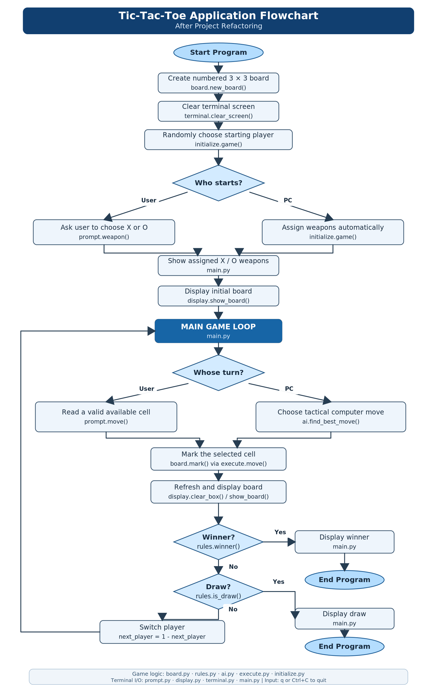

# Tic-Tac-Toe
A simple terminal-based Tic-Tac-Toe game developed in **Python 3** as a learning project. The project also serves as an introduction to **uv** for managing Python projects and virtual environments.

## Features
- Human versus computer gameplay.
- Random selection of the starting player.
- X/O selection when the human starts; automatic assignment when the computer starts.
- Numbered 3×3 board with input validation and occupied-cell protection.
- Tactical computer opponent that prioritises winning, blocking, centre, corners and sides.
- Coloured symbols and dynamic board updates using ANSI escape codes.
- Automatic detection of wins across rows, columns and diagonals.
- Draw detection when no available moves remain.
- Graceful exit by entering `q` or pressing `Ctrl+C`.

## Requirements
- Python 3.13.3 or newer.
- A terminal with ANSI escape sequence support for the intended colours and screen updates.
- Optional: 'uv' to manage the Python environment and run the program.

No external Python libraries are required.

## Installation and Usage

Clone the repository and navigate to the project directory.

Install and synchronise the project environment using uv:

```bash
uv sync
```

Run the application from the project directory:

```bash
uv run tictactoe
```

## Demo


## Flowchart



## Modules
- `board.py`: board creation, available cells, weapon symbols and move validation.
- `rules.py`: winning combinations, winner and draw detection.
- `ai.py`: tactical computer moves — win, block, center, corner or side.
- `display.py`: coloured symbols, board rendering and display updates.
- `prompt.py`: user input, validation and quit handling.
- `initialize.py`: random starting player selection and weapon assignment.
- `execute.py`: execute a human or computer move.
- `main.py`: game entry point, turn coordination and game loop.
- `terminal.py`: terminal screen clearing, line clearing and graceful exit.
- `ansi.py`: ANSI colour and text formatting constants.

## License
This project is licensed under the **GNU General Public License v3.0 (GPL-3.0)**. See the [LICENSE](LICENSE) file for details.
